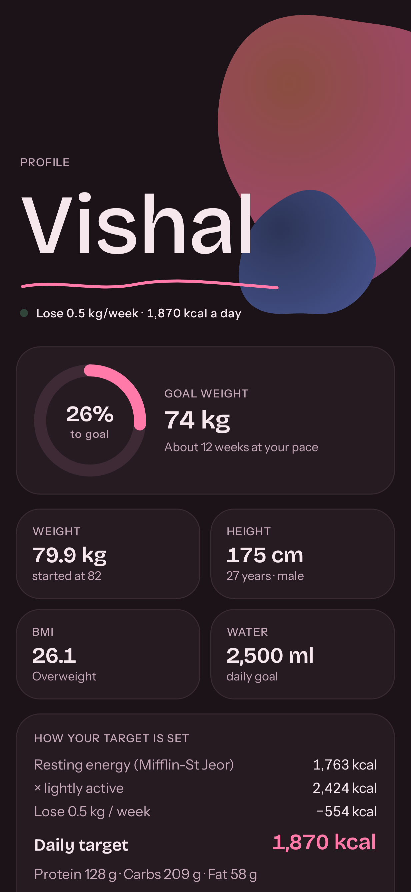

# Plate: calorie tracker for Android

Plate is an original calorie and macro tracker built with Kotlin and Jetpack Compose. All data stays on the phone and no account is needed.

<p>
  
  
  
  
</p>

## Install on your phone

1. On the phone, open this repo on GitHub and download [`release/Plate-1.3.apk`](release/Plate-1.3.apk).
2. Open the file. If Android asks, allow your browser or file manager to **install unknown apps**.
3. Tap **Install**. Requires Android 8.0 or newer.

## Features

- **Daily target**: uses the Mifflin-St Jeor resting energy formula × activity level, then adjusts for your goal (lose, maintain or gain 0.25–1 kg a week). Protein, carbs and fat targets come from the same calculation.
- **Food diary**: breakfast, lunch, dinner and snacks. Browse past days, and undo removals.
- **Food search**: a built-in list of about 60 everyday foods (including Indian staples) that works offline, plus online search and barcode-number lookup through [Open Food Facts](https://world.openfoodfacts.org) (ODbL).
- **AI lookup**: type any restaurant item ("A&W Papa Burger") and Claude searches the web for its nutrition, preferring the restaurant's own published numbers. It shows the sources and whether the figures are official, from other sites, or an estimate. Needs your own Anthropic API key (Profile → AI lookup); each lookup is billed to your Anthropic account.
- **Manual restaurant entries**: tap **Create → Per item** and enter one item's numbers from the restaurant's menu, app or nutrition guide (for example an A&W Papa Burger). After that it's one tap from your recents. Open food databases don't cover restaurant menus, so this is the reliable route.
- **Your foods**: create custom foods per item or per 100 g. Foods you use show up as recents.
- **Water**: tap drops or use +/−, toward a daily goal.
- **Progress**: weigh-ins with a trend line against your goal, and a 7-day calorie chart.
- **Profile**: goal progress ring, BMI, and a breakdown of how the target is calculated.
- Light and dark themes.

## Design

The visuals follow two plates from the *Next Design Atlas* research:

- **"Clinical, but warm"**: a blush ground with plum ink, slowly morphing peach, pink and lilac shapes, and exact numbers shown as rings.
- **"A name that responds"** (on the profile): the name's letters thicken in a wave and react when tapped, with a pen-stroke underline that draws itself.
- **"Calm money"** (on Progress): a thin line chart that draws itself, with tabular digits.

Fonts: Bricolage Grotesque (display) and Instrument Sans (text), both under the SIL Open Font License.

## Build

```bash
./gradlew assembleRelease        # app/build/outputs/apk/release/app-release.apk
./gradlew testDebugUnitTest      # unit tests + renders docs/screenshots/*.png
```

The release build is signed with the debug key so it installs directly. Create your own signing key before publishing to a store.

Calorie targets are estimates, not medical advice.
