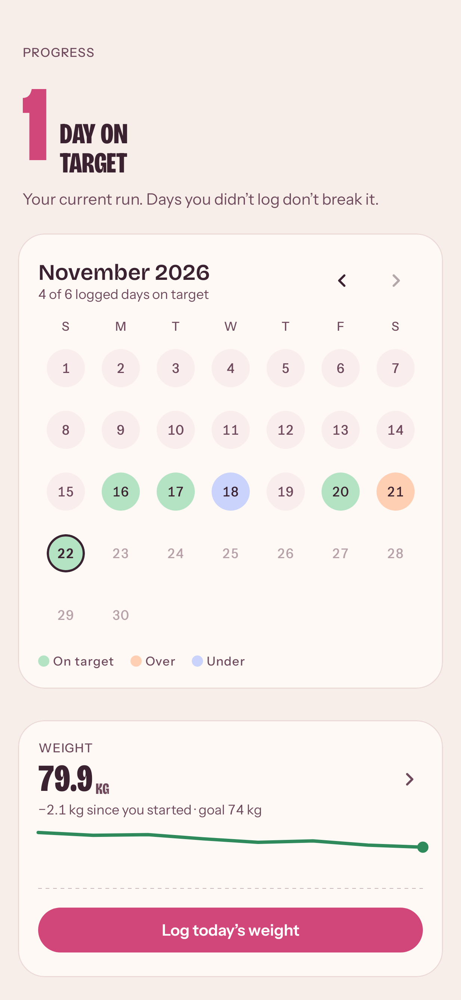

# Plate: calorie tracker for Android

Track calories and macros. No account, everything stays on your phone.

**Website and download:** [mrboora04.github.io/ICE3](https://mrboora04.github.io/ICE3/)

<p align="center">
  <a href="https://raw.githubusercontent.com/mrboora04/ICE3/main/release/Plate.apk"></a>
</p>

<p>
  
  
  
  
</p>

## What you can do

- Daily calorie and macro target, set to your goal
- Log meals in a food diary
- Search 6,000+ Canadian foods, or scan a barcode
- Browse 14 Canadian restaurant menus (2,100+ items) — can't find one? Request it and we'll add it
- Track water and weight, with a progress chart
- Works offline, light and dark themes

## Install

1. Tap the download button above to get `Plate.apk`.
2. Open it and allow install from unknown sources. Android 8.0+.

Plate checks for new versions itself: when one is out, the Today screen shows what's new and an **Update** button.

## Data and licences

- Contains information licensed under the [Open Government Licence – Canada](https://open.canada.ca/en/open-government-licence-canada): Health Canada, *Canadian Nutrient File, 2026*.
- Restaurant menus come from each chain's official Canadian nutrition info, with sources in `canada_restaurants.csv`. Restaurants that publish none (e.g. Amaya) are marked as estimates and shown with ≈. Plate isn't affiliated with any restaurant.
- Also uses USDA [FoodData Central](https://fdc.nal.usda.gov) (public domain) and [Open Food Facts](https://world.openfoodfacts.org) (Open Database License).

Calorie targets are estimates, not medical advice.

## For developers

```bash
./gradlew assembleRelease     # app/build/outputs/apk/release/app-release.apk
./gradlew testDebugUnitTest   # tests, and renders docs/screenshots/*.png
```

**Releasing an update:** bump `versionCode`/`versionName` in `app/build.gradle.kts`, build with Plate's release key (configured in `local.properties`, never committed; updates only install over an existing Plate signed with the same key), copy the APK to `release/Plate.apk`, and update `release/latest.json` (version and two or three short `notes`). Push to `main`.
