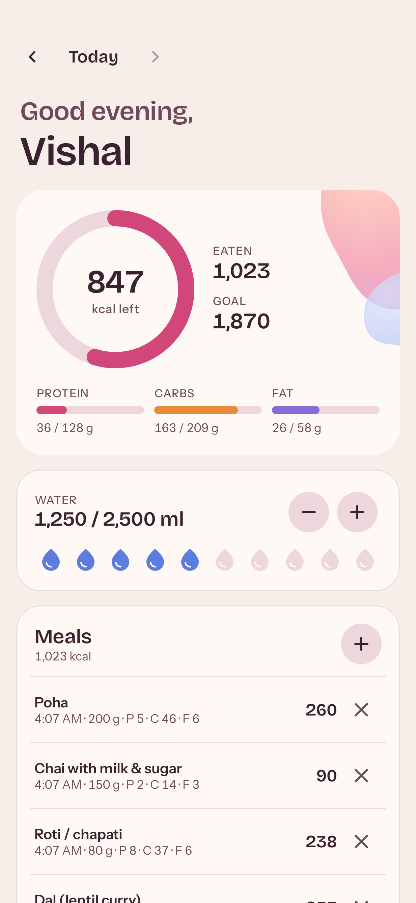
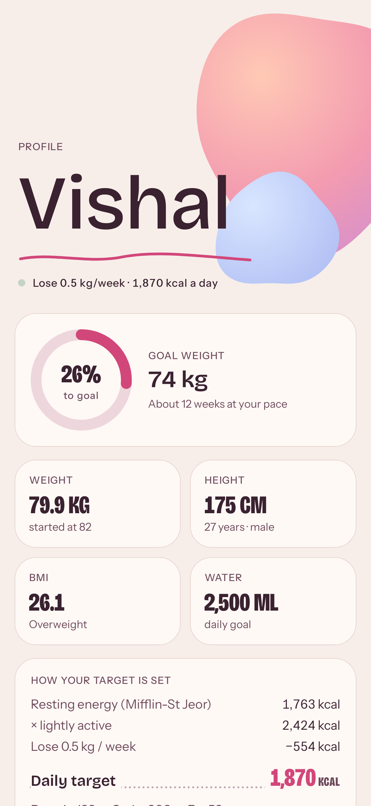

# Plate: calorie tracker for Android

Plate is an original calorie and macro tracker built with Kotlin and Jetpack Compose. All data stays on the phone and no account is needed.

<p>
  
  
  
  
</p>

## Install on your phone

1. On the phone, open this repo on GitHub and download [`release/Plate-1.9.apk`](release/Plate-1.9.apk).
2. Open the file. If Android asks, allow your browser or file manager to **install unknown apps**.
3. Tap **Install**. Requires Android 8.0 or newer.

## Features

- **Daily target**: uses the Mifflin-St Jeor resting energy formula × activity level, then adjusts for your goal (lose, maintain or gain 0.25–1 kg a week). Protein, carbs and fat targets come from the same calculation.
- **Food diary**: one list of the day's meals with the time each was logged. Browse past days, and undo removals.
- **Food search**: about 6,000 foods from Health Canada's Canadian Nutrient File (2026) plus 60 everyday staples (including Indian dishes), all offline and free, plus online search and camera barcode scanning through [Open Food Facts](https://world.openfoodfacts.org) (ODbL).
- **Browse**: Restaurants, with official Canadian menus for Tim Hortons, Dairy Queen, McDonald's, Pizza Pizza, Subway, KFC, Mary Brown's, Popeyes and Starbucks (about 1,350 items), plus US menus for other chains such as Burger King and Wendy's, plus shelves like Drinks, Fast food, Snacks, Meals & dishes, Fruit and more. Every item has a + to log its usual serving.
- **Manual restaurant entries**: tap **Create → Per item** and enter one item's numbers from the restaurant's menu, app or nutrition guide (for example an A&W Papa Burger). After that it's one tap from your recents. Open food databases don't cover restaurant menus, so this is the reliable route.
- **Your foods**: create custom foods per item or per 100 g. Foods you use show up as recents.
- **Water**: tap drops or use +/−, toward a daily goal.
- **Progress**: weigh-ins with a trend line against your goal, and a 7-day calorie chart.
- **Profile**: goal progress ring, BMI, and a breakdown of how the target is calculated.
- Light and dark themes.

## Design

The visuals follow two plates from the *Next Design Atlas* research:

- **"Clinical, but warm"**: a blush ground with plum ink, slowly morphing peach, pink and lilac shapes, and exact numbers shown as rings.
- **"A name that responds"** (on the profile): the name's letters thicken in a wave and react when tapped, with a pen-stroke underline that draws itself.
- **"Calm money"** (on Progress): a thin line chart that draws itself, with tabular digits.

Fonts: Bricolage Grotesque (display) and Instrument Sans (text), both under the SIL Open Font License.

## Build

```bash
./gradlew assembleRelease        # app/build/outputs/apk/release/app-release.apk
./gradlew testDebugUnitTest      # unit tests + renders docs/screenshots/*.png
```

The release build is signed with the debug key so it installs directly. Create your own signing key before publishing to a store.

## Data and licences

- Contains information licensed under the [Open Government Licence – Canada](https://open.canada.ca/en/open-government-licence-canada): Health Canada, *Canadian Nutrient File, 2026* (`app/src/main/assets/cnf_foods.csv`, reduced to energy, protein, carbohydrate, fat and one household measure per food).
- Canadian restaurant menus (`canada_restaurants.csv`) collected from each chain's official Canadian nutrition information in November 2026; each row records its source URL. The McDonald's figures come from their 2019 nutrition PDF, so newer items are missing.
- Restaurant menu items from USDA [FoodData Central](https://fdc.nal.usda.gov) SR Legacy (public domain); US recipes, so Canadian menus can differ.
- Online food data from [Open Food Facts](https://world.openfoodfacts.org), under the Open Database License.

Calorie targets are estimates, not medical advice.
