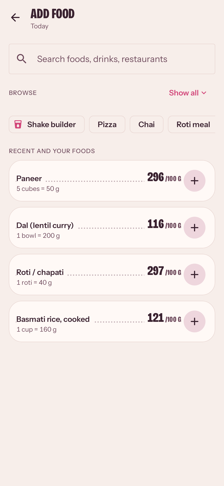

# Plate: calorie tracker for Android

Track calories and macros. No account, everything stays on your phone.

  

  
  
  
  

## What you can do

- Daily calorie and macro target, set to your goal
- Log meals in a food diary
- Search 6,000+ Canadian foods, or scan a barcode
- Browse 14 Canadian restaurant menus (2,100+ items) — can't find one? Request it and we'll add it
- Track water and weight, with a progress chart
- Works offline, light and dark themes

## Install

1. Tap the download button above to get `Plate.apk`.
2. Open it and allow install from unknown sources. Android 8.0+.

Food data: Health Canada, Open Food Facts, and official chain menus. Calorie targets are estimates, not medical advice.
